# Luna

Explorador de archivos para Linux escrito en C++ con Qt 6: una alternativa ligera a
Nautilus, pensada para el escritorio [Omarchy](https://omarchy.org) (usa los colores
de su tema y lanza las aplicaciones como él), pero que funciona en cualquier
escritorio. Lleva el nombre de Luna, en honor a mi gata siamesa, que es también su icono.


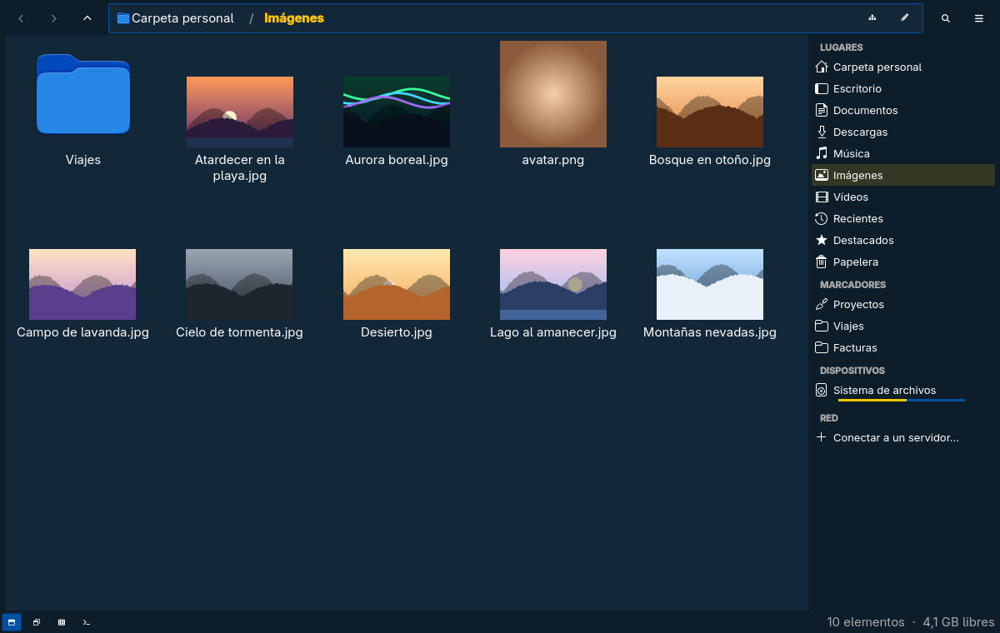

| Lista detallada | Vista dividida |
|---|---|
| 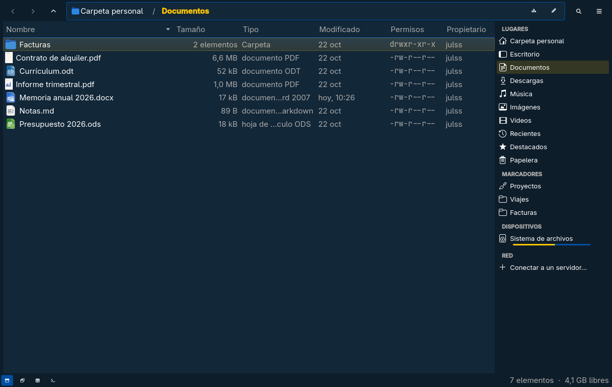 | 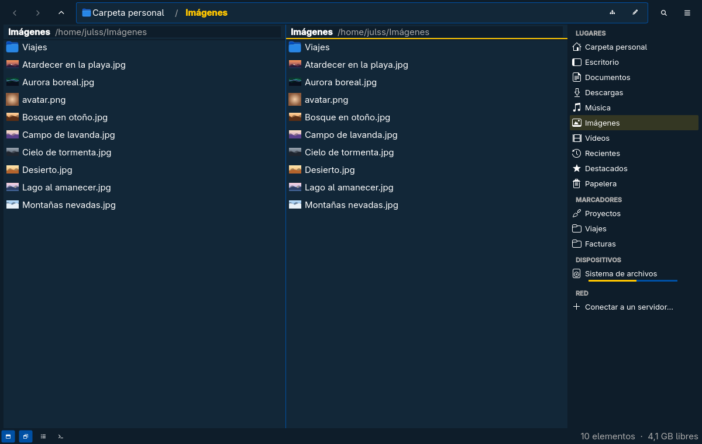 |
| **Vista previa: la portada de un Word** | **Un comprimido como árbol, sin extraerlo** |
| 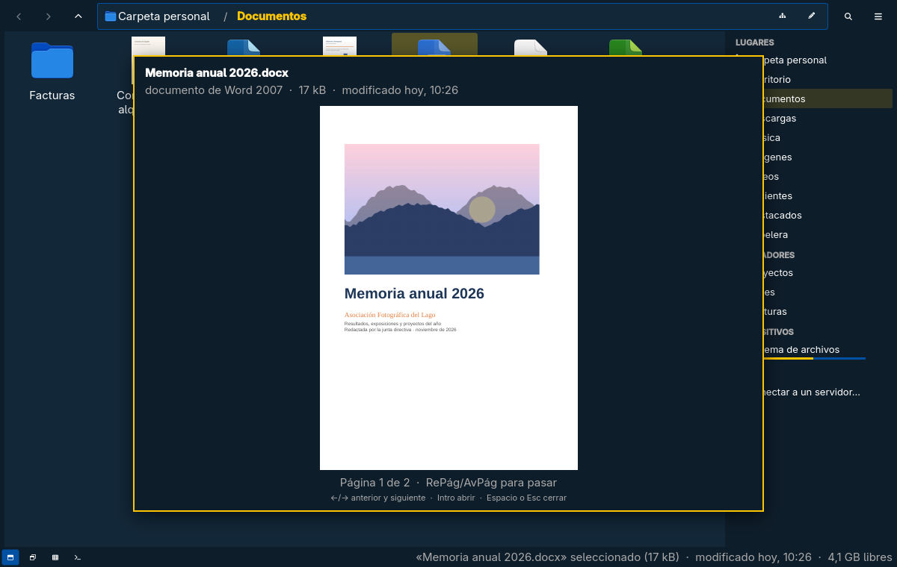 | 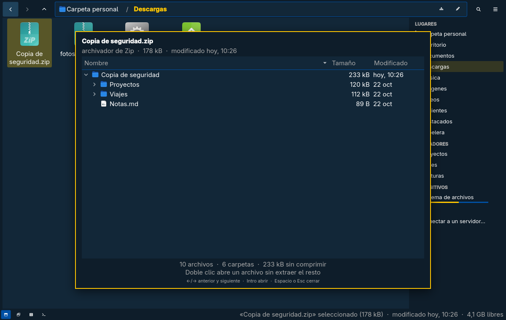 |
| **Menú Git en un repositorio** | **Comprimir y cifrar, como Kleopatra** |
| 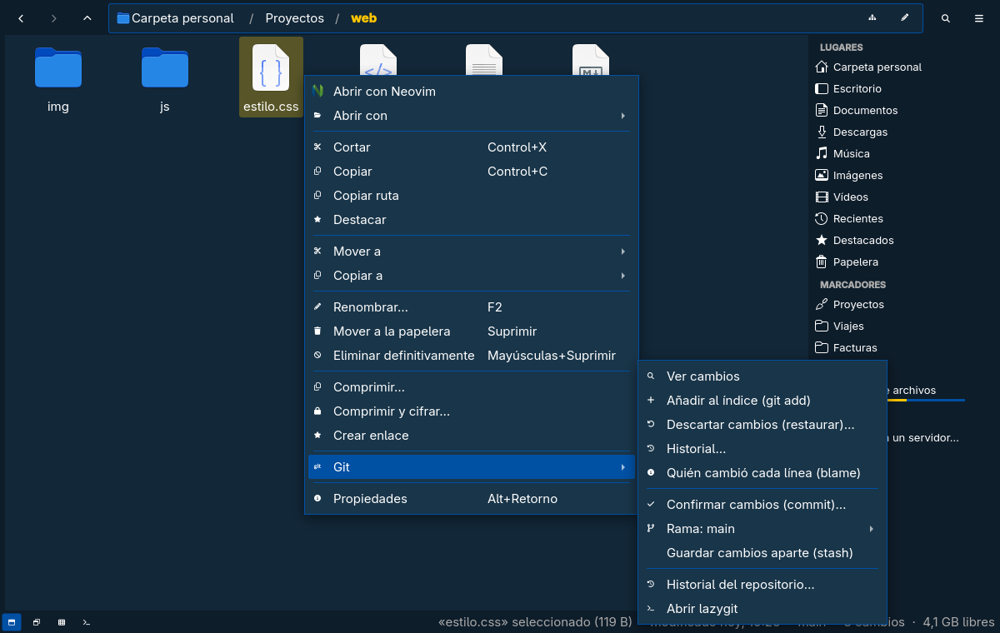 | 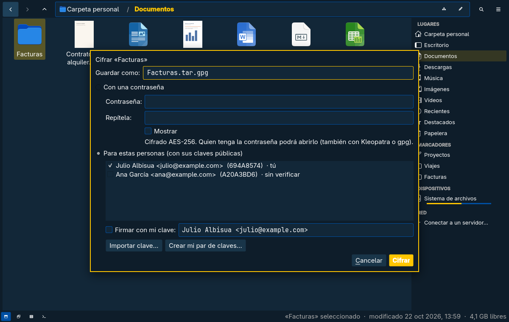 |
| **Terminal integrado (F4)** | **Columnas** |
| 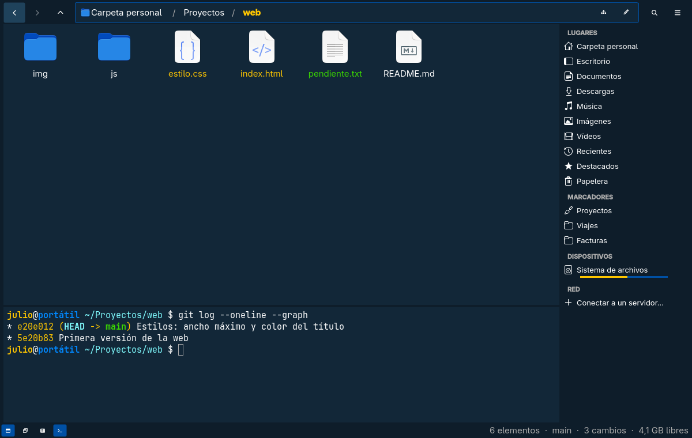 | 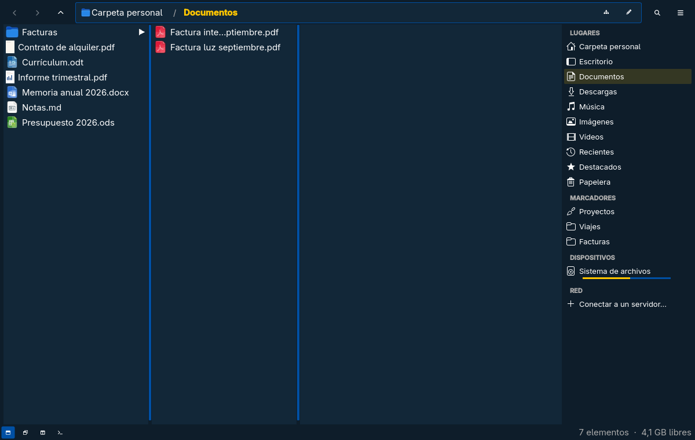 |
| **Metadatos de una foto (EXIF y GPS)** | **Permisos** |
| 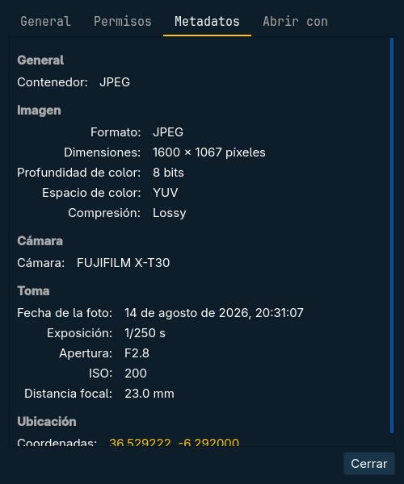 | 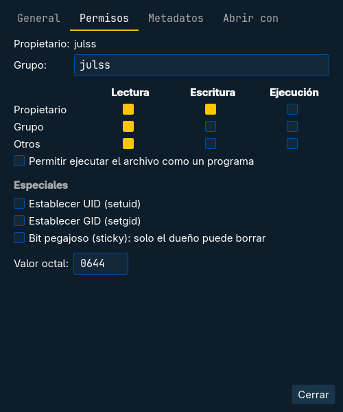 |
| **Conectar a un servidor** | **Ajustes** |
| 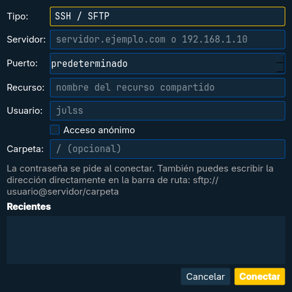 | 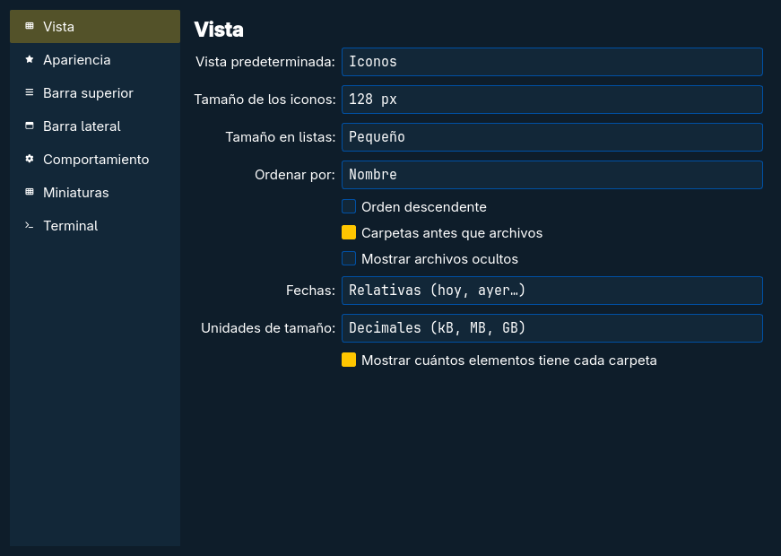 |

*Las capturas usan una carpeta personal de ejemplo (archivos, claves y repositorio
inventados) y el tema Cobalt2 de Omarchy.*

## Qué hace

- **Vistas:** iconos, compacta, lista, lista detallada, árbol y columnas; pestañas y
  vista dividida en la misma ventana.
- **Barra de ruta** al estilo de Nautilus, como botones o como texto editable.
- **Barra lateral** con lugares, marcadores (los mismos que GTK y Nautilus),
  dispositivos extraíbles (montar y expulsar) y red.
- **Archivos:** abrir con (respeta `mimeapps.list`), mover a / copiar a, copiar y
  mover con progreso y gestión de conflictos, papelera estándar, renombrar en lote,
  comprimir y extraer, enlaces, deshacer y rehacer.
- **Cifrar** como Kleopatra (GnuPG): «Comprimir y cifrar…» con una contraseña
  (AES-256) o para las claves públicas de otras personas, firmando con la tuya;
  `archivo.gpg`, `carpeta.tar.gpg`. Doble clic o «Descifrar aquí» lo abre.
- **Vista previa** con la barra espaciadora: fotos, páginas de PDF, texto,
  Markdown con formato, documentos de Word/Excel/PowerPoint/LibreOffice desde
  la portada (LibreOffice, guardado en caché), un fotograma o la carátula de
  vídeos y canciones con sus datos (de las canciones suenan 30 segundos de la
  mitad, con P para pausar); ← / → recorren la carpeta. Los comprimidos
  se ven como árbol con todas sus carpetas, y un doble clic abre un archivo de
  dentro sin extraer el resto.
- **Ir a una carpeta** (Ctrl + P) escribiendo trozos de su ruta, con las carpetas
  frecuentes de zoxide y tus marcadores; Luna le cuenta a zoxide dónde vas.
- **Buscar** por nombre o dentro de los archivos (ripgrep, a prioridad mínima),
  y filtrar por fecha de modificación y tamaño.
- **git:** en un repositorio, los nombres se colorean (modificado, nuevo,
  conflicto) y la barra de abajo muestra la rama y los cambios. El botón derecho
  tiene un menú «Git» según el estado: ver cambios, añadir o quitar del índice,
  restaurar, historial (y volver a una versión), blame, ignorar, confirmar,
  pull/push, ramas y stash.
- **Imágenes:** girar, reducir tamaño y convertir a JPG/PNG/WebP (ImageMagick).
- **Terminal integrado** abajo (F4) que sigue la carpeta; un clic en un archivo
  escribe su nombre y arrastrar archivos escribe sus rutas.
- **Omarchy:** sigue el tema en vivo, abre archivos en otro escritorio (clic
  derecho → *Abrir en el escritorio*) y navega atrás/adelante deslizando dos
  dedos en horizontal, como el navegador.
- **Propiedades:** permisos (casillas, octal, bits especiales, recursivo) y
  metadatos de audio y vídeo (libmediainfo) y de fotos, con EXIF y GPS (exiv2).
- **Conectar a un servidor:** SFTP/SSH, FTP, FTPS, SMB y NFS a través de GVFS. Los
  servidores SFTP de la red aparecen solos en *Red*, también el móvil con
  [Luna Android](https://github.com/julssvanderhaack/luna-android) (avahi).
- **Carpetas de root:** en una carpeta que no puedes leer, *Abrir como
  administrador* pide la contraseña (polkit) y la abre como Nautilus, por
  `admin://` de GVFS. Dentro se puede copiar hacia fuera y hacia dentro,
  renombrar, crear y eliminar; los archivos se abren como copia de solo lectura.
  También `luna admin:///etc` o escribirlo en la barra de ruta.
- **Tus apps:** reproducir carpetas en Sonata y ver qué ocupa espacio con
  julss.disk, cuando están instalados.
- **Rápido y ligero:** listado en hilos aparte, búsqueda recursiva a prioridad
  mínima con `getdents64`, miniaturas en la caché compartida de freedesktop (las
  mismas que usa Nautilus) con vista previa EXIF al instante. No consume CPU en
  reposo.
- **Muy configurable:** barra superior (solo iconos, iconos y texto, o agrupados),
  tamaños, columnas, comportamiento al abrir… en *Ajustes*.
- **Idiomas:** español e inglés (EE. UU.). Sigue el idioma del sistema y se puede
  cambiar en *Ajustes → Apariencia → Idioma*. Ver [Traducir Luna](#traducir-luna).

## Instalar desde el zip

El zip de cada [versión](https://github.com/julssvanderhaack/luna/releases) trae el
ejecutable ya compilado para x86-64. Está enlazado con las bibliotecas del sistema,
así que necesitas versiones al menos tan recientes como aquellas con las que se
compiló (**Qt 6.12**, exiv2 0.28, poppler 26): en la práctica, Omarchy o cualquier
distribución basada en Arch al día.

```sh
sudo pacman -S --needed qt6-base qt6-svg libmediainfo exiv2 poppler-qt6 libarchive libvterm ffmpeg libpipewire
# opcionales: miniaturas de vídeo, servidores remotos, comprimir/extraer,
# buscar dentro de archivos, imágenes, servidores de la red, Ctrl + P,
# portadas de documentos de Office, cifrar y git
sudo pacman -S --needed ffmpegthumbnailer gvfs gvfs-smb 7zip ripgrep imagemagick avahi zoxide libreoffice-fresh gnupg git
unzip luna-1.3.0-linux-x86_64.zip
cd luna-1.3.0-linux-x86_64
./install.sh            # en ~/.local (sin sudo)
# sudo ./install.sh --system   # para todos los usuarios, en /usr/local
```

`./install.sh --uninstall` (o `sudo ./install.sh --system --uninstall`) lo quita.

Luna no se pone como explorador predeterminado al instalarlo. Para hacerlo:

```sh
xdg-mime default luna.desktop inode/directory
```

En otras distribuciones, o si el ejecutable se queja de alguna biblioteca, compílalo.

## Compilar

Necesitas un compilador con C++17, CMake ≥ 3.20, Qt 6 (Widgets, Svg),
libmediainfo, exiv2, poppler-qt6 y libarchive.

```sh
# Arch: sudo pacman -S --needed base-devel cmake qt6-base qt6-svg libmediainfo exiv2 poppler-qt6 libarchive libvterm ffmpeg libpipewire
# opcionales: libvterm (terminal integrado), ffmpeg y libpipewire (escuchar canciones en la vista previa)
cmake -S . -B build -DCMAKE_BUILD_TYPE=Release
cmake --build build -j"$(nproc)"
cmake --install build --prefix ~/.local
```

Por defecto se optimiza para el procesador de la máquina que compila
(`-march=native`); `-DLUNA_NATIVE=OFF` genera un ejecutable para cualquier x86-64.

## Pruebas

```sh
cmake -S . -B build-test -DLUNA_TESTS=ON
cmake --build build-test -j"$(nproc)"
ctest --test-dir build-test --output-on-failure
```

Las pruebas (`tests/`, con QtTest) cubren copiar, mover, borrar y la papelera
(enlaces que no se siguen, permisos setuid/setgid que no se copian), leer
comprimidos, la carpeta privada de los archivos abiertos desde ellos, que las
contraseñas no queden en las direcciones recientes, el listado de carpetas,
cifrar y descifrar con gpg, el entrecomillado del terminal y que la traducción
esté completa. Cada una corre con su propio `HOME` vacío dentro de la carpeta de
compilación: no tocan tu configuración, tu papelera ni tus claves.

`-DLUNA_SANITIZE=ON` compila con AddressSanitizer y UBSan. El
[CI](.github/workflows/ci.yml) pasa las pruebas en Arch de las dos formas en
cada `push`.

`-DLUNA_TEST_HOOKS=ON` mete en el ejecutable los ganchos `LUNA_*` (capturas,
recorrido de la interfaz, pruebas de arrastrar, git y gpg) que se usan para
desarrollar; el ejecutable normal no los lleva.

## Traducir Luna

Los textos se escriben en español en el código, marcados con `i18n("…")` (o
`I18N_NOOP("…")` en listas de `const char *`). Cada idioma es un fichero de
Qt Linguist en `i18n/luna_<código>.ts` que va dentro del ejecutable; no hace
falta `qt6-tools` para compilar.

```sh
i18n/update.py        # recoge los textos nuevos en todos los .ts
i18n/update.py fr     # empieza i18n/luna_fr.ts
```

Traduce el `.ts` (con Qt Linguist o un editor de texto), añádelo a
`data/luna.qrc` y recompila. Con el idioma del sistema en uno que Luna no tiene,
se usa el inglés. Los diálogos propios de Qt (botones estándar, menú de los
campos de texto) salen de `qt6-translations`.

## Atajos de teclado

| Tecla | Acción |
|---|---|
| Alt + ← / → / ↑, Retroceso | Atrás / adelante / carpeta superior |
| Ctrl + L | Escribir una ruta |
| Ctrl + P | Ir a una carpeta (zoxide y marcadores) |
| Ctrl + F o empezar a escribir | Filtrar (Intro busca en subcarpetas) |
| Ctrl + T / Ctrl + W, Ctrl + Tab | Pestañas |
| F3 / F6 | Vista dividida / cambiar de panel |
| F9 | Barra lateral |
| Ctrl + 1 … 6 | Iconos, compacta, lista, detallada, árbol, columnas |
| Ctrl + rueda, Ctrl + / − | Tamaño de los iconos |
| Ctrl + H | Mostrar archivos ocultos |
| F2 | Renombrar (en lote si hay varios) |
| Supr / Mayús + Supr | Papelera / eliminar definitivamente |
| Ctrl + C / X / V | Copiar / cortar / pegar |
| Ctrl + Z / Ctrl + Mayús + Z | Deshacer / rehacer |
| Ctrl + Mayús + N | Nueva carpeta |
| Alt + Intro | Propiedades |
| Espacio | Vista previa (← / → anterior y siguiente, Intro abrir) |
| F4 / Mayús + F4 | Terminal integrado / terminal aparte |
| Dos dedos a los lados | Atrás / adelante |
| Ctrl + D | Añadir a marcadores |
| Ctrl + , | Ajustes |

Los ajustes se guardan en `~/.config/luna/luna.conf`.

## Licencia

[GPL-3.0](LICENSE).
